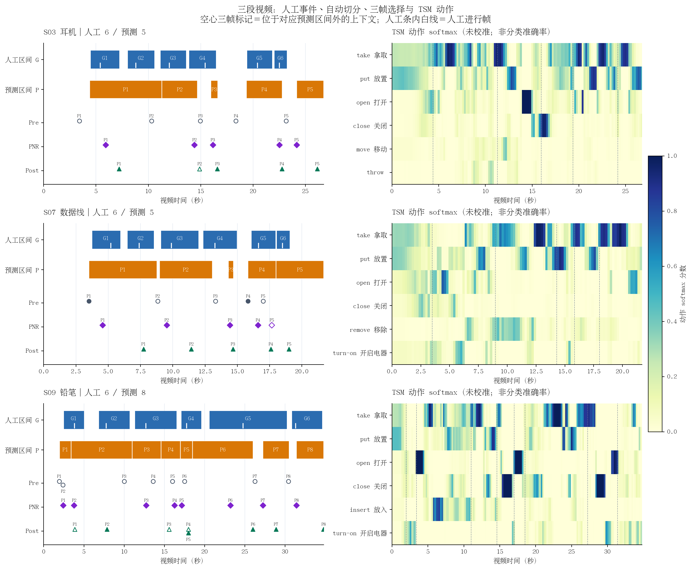
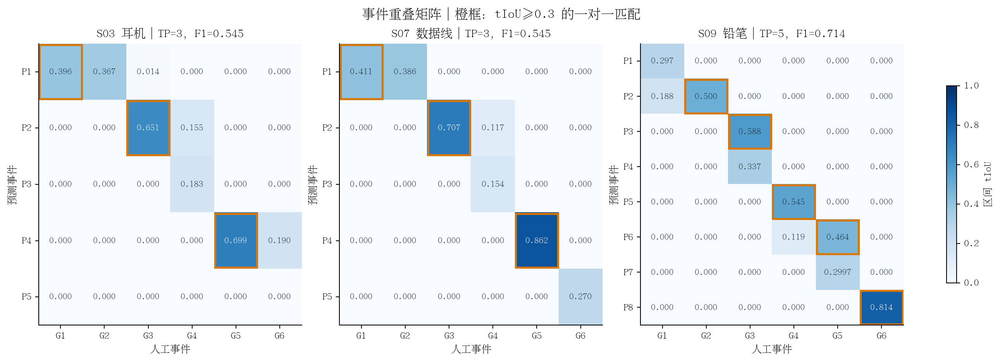

# 三段事件切分、动作分类与三帧对照（2026-11-18）

人工真值来自原始录制目录中的 `*_三帧.md`，各 6 个，共 18 个；预测来自完整运行 v4，共 5/5/8 个。模型与阈值未重跑、未按本次结果调参。

## 事件匹配结果

采用源帧闭区间 tIoU=交集帧数/并集帧数。在每段视频内一对一匹配：先最大化达到阈值的匹配数量，再最大化总 tIoU。主表用先前讨论的 0.3，同时报告 0.5/0.7。

| 录制 | 人工/预测 | TP/FP/FN @0.3 | Precision | Recall | F1 | 未匹配人工 | 未匹配预测 |
| --- | --- | --- | --- | --- | --- | --- | --- |
| S03 耳机 | 6/5 | 3/2/3 | 0.600 | 0.500 | 0.545 | G2, G4, G6 | P3, P5 |
| S07 数据线 | 6/5 | 3/2/3 | 0.600 | 0.500 | 0.545 | G2, G4, G6 | P3, P5 |
| S09 铅笔 | 6/8 | 5/3/1 | 0.625 | 0.833 | 0.714 | G1 | P1, P4, P7 |

| tIoU 阈值 | 总 TP/FP/FN | Micro-P | Micro-R | Micro-F1 |
| --- | --- | --- | --- | --- |
| 0.3 | 11/7/7 | 0.611 | 0.611 | 0.611 |
| 0.5 | 8/10/10 | 0.444 | 0.444 | 0.444 |
| 0.7 | 3/15/15 | 0.167 | 0.167 | 0.167 |

FP/FN 是在给定 tIoU 门槛下未匹配的预测/人工区间；一个人工事件可能已被预测部分覆盖，却因区间太短或延伸太长未匹配。不能把所有 FN 都直接解释为完全没有检测到动作。





## 主要偏差

- S03：P1=132–338 覆盖 G1=135–216 和 G2=241–316；P2 又同时覆盖 G3 和 G4 的开头。P4=581–683 覆盖 G5 及 G6 的前段。P5=725–802 位于全部人工事件之后。数量少 1 并不能概括这些合并、碎片和额外区间。
- S07：P1=105–262 合并 G1/G2；P2=269–391 包含 G3 和 G4 开头，P3 仅覆盖 G4 后段。P5 包含完整 G6，但结束延至视频末尾 650，tIoU 只有 0.270，低于 0.3。
- S09：G3 被 P3/P4 分拆，G5 被 P6/P7 分拆；P2 同时覆盖 G1 后段与 G2，P6 还跨越 G4/G5。P1 与 G1 的 tIoU 为 0.297，接近但低于 0.3。

- 切分和三帧还会发生错位：S03 P2 的最佳区间匹配为 G3，但 PNR=432 位于 G4；S03 P4 匹配 G5，但 PNR=676 位于 G6。S07 P5 的 PNR=530 早于预测起点 540，属于 G5；S09 P2 匹配 G2，但 PNR=113 位于 G1。这些是按人工区间得到的时间归属，不是已完成人工视觉验收。

## 数值口径

- 动作表的分数是在该预测区间内、以动作窗口中心帧为准，对全部 TSM softmax 向量取均值后的 Top-3；包括未通过动作门槛的窗口。候选比例另列。它不是事件正确概率。
- 阶段序列来自已保存的动作阶段诊断，按阶段开始时间排列；原始 `action_phases` 是无序集合，未将其字母排序误当时序。热图固定展示 take/put/open/close，另加全片平均分最高的两个其余动词。
- 原始人工标注没有动作类别、操作对象或经过复核的 PNR 真值，因此不报告动作分类准确率。人工“进行帧”仅作时间参考，不能默认等于模型 PNR。TSM noun 与 YOLO 接触对象是两个独立输出。
- 三帧可取已登记的前后文，所以有些帧落在预测区间之外，图中用空心标记。部分三帧跨度还会跨人工事件；这是一项需复核的现象，不据此直接认定语义正确。
- 当前输出没有经过校准的事件置信度。边界诊断 `score` 可能来自动作阶段 softmax 或视觉差异，不同来源不能视为同一种概率；q 是充分性估计，与 tIoU、动作分数也不同。

## S03 耳机／184551

### 原始人工事件

| ID | 开始帧 | 进行帧 | 结束帧 | 时间范围（秒） |
| --- | --- | --- | --- | --- |
| G1 | 135 | 162 | 216 | 4.50–7.20 |
| G2 | 241 | 264 | 316 | 8.03–10.53 |
| G3 | 335 | 360 | 407 | 11.17–13.57 |
| G4 | 417 | 463 | 493 | 13.90–16.43 |
| G5 | 583 | 613 | 654 | 19.43–21.80 |
| G6 | 662 | 676 | 696 | 22.07–23.20 |

### 预测切分与三帧

| ID | 预测起止帧（秒） | 最佳人工/tIoU | 一对一匹配 @0.3 | 起/止偏移秒 | Pre/PNR/Post | PNR时间归属 | 事件 q（来源） |
| --- | --- | --- | --- | --- | --- | --- | --- |
| P1 | 132–338 (4.40–11.27) | G1/0.3961 | G1 | -0.10/+4.07 | 102/178/216 | G1 | 0.300（视觉估计） |
| P2 | 339–440 (11.30–14.67) | G3/0.6509 | G3 | +0.13/+1.10 | 309/432/447 | G4 | 0.500（视觉估计） |
| P3 | 479–498 (15.97–16.60) | G4/0.1829 | 未匹配 | — | 449/485/498 | G4 | 0.300（视觉估计） |
| P4 | 581–683 (19.37–22.77) | G5/0.6990 | G5 | -0.07/+0.97 | 551/676/683 | G6 | 0.600（视觉估计） |
| P5 | 725–802 (24.17–26.73) | 无/0.0000 | 未匹配 | — | 695/725/784 | 人工区间外 | 0.300（视觉估计） |

正偏移表示预测更晚，负偏移表示预测更早；偏移仅对成功匹配的区间计算。

### 动作分类与接触对象

| ID | TSM 动词 Top-3 均分 | 阶段时序（预测） | 候选窗口比例 | TSM 名词 Top-1 | YOLO 接触目标 |
| --- | --- | --- | --- | --- | --- |
| P1 | take 0.470；put 0.122；open 0.086 | 拿取/移开 | 65.7% | bag 0.099 | box |
| P2 | take 0.264；open 0.242；put 0.211 | 拿取/移开 → 放置/归位 → 打开 | 76.5% | drawer 0.241 | cabinet |
| P3 | close 0.872；take 0.057；put 0.023 | 关闭 | 100.0% | drawer 0.344 | unknown |
| P4 | take 0.490；put 0.253；open 0.153 | 拿取/移开 → 放置/归位 → 拿取/移开 | 82.4% | towel:kitchen 0.155 | unknown |
| P5 | take 0.347；put 0.317；open 0.103 | 拿取/移开 → 放置/归位 | 71.4% | jar 0.099 | phone |

### 边界依据与原始分数

| 预测 ID | 切分依据 | 规则决策帧 | 原始分数（未校准） |
| --- | --- | --- | --- |
| P1 | 接触段起点 | 无分数：接触段起点 | — |
| P2 | 视觉变化并观察到释放 | 339 | 0.000000 |
| P3 | 接触段起点 | 无分数：接触段起点 | — |
| P4 | 接触段起点 | 无分数：接触段起点 | — |
| P5 | 接触段起点 | 无分数：接触段起点 | — |

规则决策帧与实际区间起点可能不同：例如决定在间隙切分后，下一段从首个实际接触帧开始。

## S07 数据线／192339

### 原始人工事件

| ID | 开始帧 | 进行帧 | 结束帧 | 时间范围（秒） |
| --- | --- | --- | --- | --- |
| G1 | 113 | 156 | 177 | 3.77–5.90 |
| G2 | 195 | 222 | 255 | 6.50–8.50 |
| G3 | 273 | 297 | 359 | 9.10–11.97 |
| G4 | 371 | 398 | 448 | 12.37–14.93 |
| G5 | 483 | 499 | 538 | 16.10–17.93 |
| G6 | 542 | 555 | 571 | 18.07–19.03 |

### 预测切分与三帧

| ID | 预测起止帧（秒） | 最佳人工/tIoU | 一对一匹配 @0.3 | 起/止偏移秒 | Pre/PNR/Post | PNR时间归属 | 事件 q（来源） |
| --- | --- | --- | --- | --- | --- | --- | --- |
| P1 | 105–262 (3.50–8.73) | G1/0.4114 | G1 | -0.27/+2.83 | 105/137/232 | G1 | 0.143（严格几何） |
| P2 | 269–391 (8.97–13.03) | G3/0.7073 | G3 | -0.13/+1.07 | 265/286/343 | G3 | 0.300（视觉估计） |
| P3 | 429–440 (14.30–14.67) | G4/0.1538 | 未匹配 | — | 399/433/440 | G4 | 0.300（视觉估计） |
| P4 | 475–539 (15.83–17.97) | G5/0.8615 | G5 | -0.27/+0.03 | 475/498/528 | G5 | 1.000（严格几何） |
| P5 | 540–650 (18.00–21.67) | G6/0.2703 | 未匹配 | — | 510/530/570 | G5 | 0.700（视觉估计） |

正偏移表示预测更晚，负偏移表示预测更早；偏移仅对成功匹配的区间计算。

### 动作分类与接触对象

| ID | TSM 动词 Top-3 均分 | 阶段时序（预测） | 候选窗口比例 | TSM 名词 Top-1 | YOLO 接触目标 |
| --- | --- | --- | --- | --- | --- |
| P1 | open 0.197；put 0.194；turn-on 0.130 | 打开 → 放置/归位 | 57.7% | package 0.110 | box |
| P2 | take 0.437；remove 0.254；put 0.122 | 拿取/移开 → 放置/归位 → 拿取/移开 | 81.0% | package 0.207 | unknown |
| P3 | put 0.855；insert 0.068；take 0.025 | 放置/归位 | 100.0% | orange 0.166 | unknown |
| P4 | take 0.314；put 0.280；move 0.104 | 拿取/移开 → 放置/归位 | 80.0% | whetstone 0.234 | box |
| P5 | take 0.518；open 0.137；put 0.077 | 拿取/移开 → 打开 | 80.0% | board:chopping 0.233 | cabinet |

### 边界依据与原始分数

| 预测 ID | 切分依据 | 规则决策帧 | 原始分数（未校准） |
| --- | --- | --- | --- |
| P1 | 接触段起点 | 无分数：接触段起点 | — |
| P2 | 动作完成后出现新操作 | 264 | 0.541764 |
| P3 | 接触段起点 | 无分数：接触段起点 | — |
| P4 | 接触段起点 | 无分数：接触段起点 | — |
| P5 | 动作完成后出现新操作 | 540 | 0.594426 |

规则决策帧与实际区间起点可能不同：例如决定在间隙切分后，下一段从首个实际接触帧开始。

## S09 铅笔／185159

### 原始人工事件

| ID | 开始帧 | 进行帧 | 结束帧 | 时间范围（秒） |
| --- | --- | --- | --- | --- |
| G1 | 75 | 115 | 149 | 2.50–4.97 |
| G2 | 206 | 233 | 319 | 6.87–10.63 |
| G3 | 341 | 381 | 494 | 11.37–16.47 |
| G4 | 513 | 533 | 586 | 17.10–19.53 |
| G5 | 618 | 743 | 905 | 20.60–30.17 |
| G6 | 926 | 939 | 1037 | 30.87–34.57 |

### 预测切分与三帧

| ID | 预测起止帧（秒） | 最佳人工/tIoU | 一对一匹配 @0.3 | 起/止偏移秒 | Pre/PNR/Post | PNR时间归属 | 事件 q（来源） |
| --- | --- | --- | --- | --- | --- | --- | --- |
| P1 | 59–101 (1.97–3.37) | G1/0.2967 | 未匹配 | — | 58/73/116 | 人工区间外 | 0.000（近似几何） |
| P2 | 102–329 (3.40–10.97) | G2/0.5000 | G2 | -3.47/+0.33 | 72/113/236 | G1 | 0.300（视觉估计） |
| P3 | 330–437 (11.00–14.57) | G3/0.5879 | G3 | -0.37/-1.90 | 300/382/467 | G3 | 0.600（视觉估计） |
| P4 | 438–509 (14.60–16.97) | G3/0.3373 | 未匹配 | — | 408/488/539 | G3 | 0.600（视觉估计） |
| P5 | 510–554 (17.00–18.47) | G4/0.5455 | G4 | -0.10/-1.07 | 480/514/539 | G4 | 0.600（视觉估计） |
| P6 | 555–780 (18.50–26.00) | G5/0.4644 | G5 | -2.10/-4.17 | 525/696/780 | G5 | 0.600（视觉估计） |
| P7 | 817–914 (27.23–30.47) | G5/0.2997 | 未匹配 | — | 787/817/866 | G5 | 0.600（视觉估计） |
| P8 | 942–1043 (31.40–34.77) | G6/0.8136 | G6 | +0.53/+0.20 | 912/942/1043 | G6 | 0.300（视觉估计） |

正偏移表示预测更晚，负偏移表示预测更早；偏移仅对成功匹配的区间计算。

### 动作分类与接触对象

| ID | TSM 动词 Top-3 均分 | 阶段时序（预测） | 候选窗口比例 | TSM 名词 Top-1 | YOLO 接触目标 |
| --- | --- | --- | --- | --- | --- |
| P1 | turn-on 0.327；turn-off 0.229；set 0.097 | 无可靠阶段 | 28.6% | machine:washing 0.423 | cabinet |
| P2 | take 0.275；insert 0.269；put 0.172 | 打开 → 拿取/移开 → 放置/归位 → 拿取/移开 → 放置/归位 | 78.9% | drawer 0.283 | unknown |
| P3 | take 0.353；put 0.286；close 0.127 | 拿取/移开 → 放置/归位 | 77.8% | tray 0.563 | cabinet |
| P4 | close 0.615；take 0.171；open 0.050 | 拿取/移开 → 关闭 | 91.7% | drawer 0.648 | box |
| P5 | open 0.782；press 0.066；close 0.056 | 打开 | 87.5% | drawer 0.817 | cabinet |
| P6 | take 0.387；put 0.200；close 0.153 | 关闭 → 拿取/移开 → 放置/归位 → 拿取/移开 | 78.9% | knife 0.129 | phone |
| P7 | close 0.410；take 0.263；turn-on 0.128 | 拿取/移开 → 关闭 | 93.8% | drawer 0.480 | cabinet |
| P8 | press 0.193；turn-on 0.161；take 0.118 | 打开 → 拿取/移开 | 52.6% | drawer 0.251 | cabinet |

### 边界依据与原始分数

| 预测 ID | 切分依据 | 规则决策帧 | 原始分数（未校准） |
| --- | --- | --- | --- |
| P1 | 接触段起点 | 无分数：接触段起点 | — |
| P2 | 动作完成后出现新操作 | 102 | 0.451975 |
| P3 | 动作完成后出现新操作 | 330 | 0.438982 |
| P4 | 动作完成后出现新操作 | 438 | 0.571550 |
| P5 | 动作完成后出现新操作 | 510 | 0.880512 |
| P6 | 视觉变化并观察到释放 | 555 | 0.000000 |
| P7 | 接触段起点 | 无分数：接触段起点 | — |
| P8 | 动作完成后出现新操作 | 918 | 0.884895 |

规则决策帧与实际区间起点可能不同：例如决定在间隙切分后，下一段从首个实际接触帧开始。

## 文件与复现

- [完整对照数据与输入哈希](comparison.json)
- [预测事件、动作、边界、三帧、q 的 CSV](predicted-events.csv)
- [人工事件 CSV](human-events.csv)
- [逐窗口动作分类 CSV](action-windows.csv)
- [时间轴与动作热图 PDF](figures/event-action-overview.pdf)
- [tIoU 矩阵 PDF](figures/event-iou-matrices.pdf)

```bash
pip install matplotlib fonttools
python3 scripts/compare_event_segments.py \
  --run-root /data/storage/peekaboo-runs/full_numeric_20261118_v4 \
  --output docs/event-comparison
```

这是对已保存完整运行的只读分析，没有修改模型输出，也没有使用人工区间重新生成预测。
