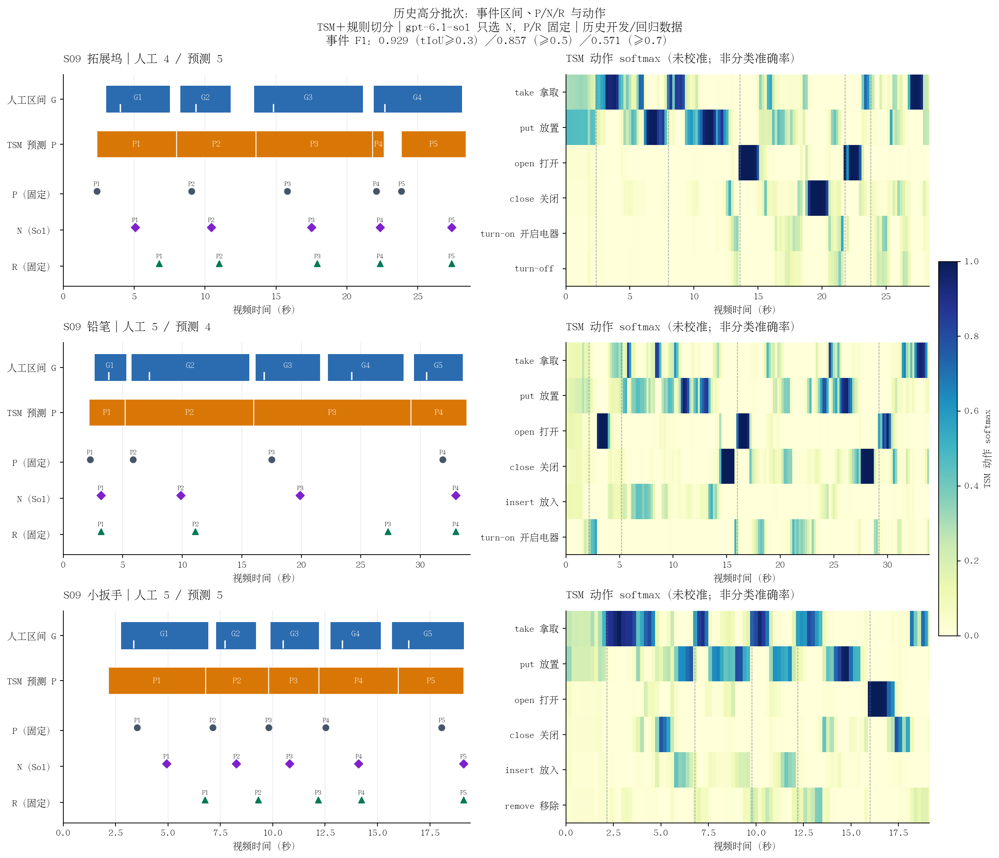

# 历史高分批次 event-action-overview

绘图日期：2026-11-19。原始实验：2026-11-17。

该批实际模型为 **gpt-6.1-sol**，19 份历史请求回执的请求/返回型号均一致。TSM＋规则先切分事件，P/R 固定为有效接触簇首尾，Sol 只从候选图中选择 N。没有将该批标为 Qwen 27B。

## 原始指标复核

| 事件 tIoU 门槛 | 匹配/预测/人工 | Precision | Recall | F1 |
| --- | --- | --- | --- | --- |
| 0.3 | 13/14/14 | 0.929 | 0.929 | 0.929 |
| 0.5 | 12/14/14 | 0.857 | 0.857 | 0.857 |
| 0.7 | 8/14/14 | 0.571 | 0.571 | 0.571 |

0.7 是区间匹配门槛；该门槛下 F1=0.571。0.929/0.857 是上游事件匹配成绩，不是 Sol 或三帧的语义准确率。



蓝色条为人工事件，橙色条为自动事件，白色短线为人工进行帧；三个点行分别为固定 P、Sol 选择 N、固定 R。右侧仅使用该批事件生成时实际引用的 TSM 动作概率，已按原始事件 manifest 的动作文件/manifest 哈希匹配。动作分数未校准为分类准确率。

## 逐录制与逐事件

| 录制 | 人工事件 | 预测事件 | F1@0.3 | F1@0.5 | F1@0.7 |
| --- | --- | --- | --- | --- | --- |
| S09 拓展坞／183908 | 4 | 5 | 0.889 | 0.889 | 0.444 |
| S09 铅笔／183906 | 5 | 4 | 0.889 | 0.667 | 0.667 |
| S09 小扳手／185458 | 5 | 5 | 1.000 | 1.000 | 0.600 |

### 拓展坞／183908

人工帧（开始/进行/结束）：G1=91/121/225；G2=248/281/353；G3=404/445/633；G4=657/680/842

| ID | 自动区间 | P / Sol N / R | 原规则 N | Sol 状态/需复核 | TSM 动词 Top-3 区间均分 |
| --- | --- | --- | --- | --- | --- |
| P1 | 71–239 | 71/152/203 | 116 | complete / 否 | take 0.396；put 0.368；remove 0.064 |
| P2 | 240–407 | 271/313/330 | 300 | complete / 是 | put 0.446；take 0.221；close 0.052 |
| P3 | 408–653 | 474/525/537 | 537 | complete / 否 | close 0.262；open 0.213；put 0.135 |
| P4 | 654–678 | 662/670/670 | 670 | complete / 是 | open 0.922；turn-on 0.036；press 0.019 |
| P5 | 715–851 | 715/821/821 | 768 | complete / 是 | take 0.331；put 0.108；turn-off 0.090 |

### 铅笔／183906

人工帧（开始/进行/结束）：G1=79/115/158；G2=172/217/468；G3=485/506/646；G4=667/727/857；G5=884/916/1006

| ID | 自动区间 | P / Sol N / R | 原规则 N | Sol 状态/需复核 | TSM 动词 Top-3 区间均分 |
| --- | --- | --- | --- | --- | --- |
| P1 | 65–155 | 68/95/95 | 87 | complete / 是 | open 0.383；turn-on 0.122；take 0.121 |
| P2 | 156–479 | 176/296/333 | 268 | complete / 否 | put 0.308；insert 0.152；take 0.146 |
| P3 | 480–875 | 525/597/818 | 588 | complete / 否 | put 0.202；close 0.191；turn-on 0.099 |
| P4 | 876–1016 | 956/989/989 | 981 | complete / 否 | take 0.315；open 0.195；press 0.095 |

### 小扳手／185458

人工帧（开始/进行/结束）：G1=83/101/207；G2=219/232/275；G3=297/315/365；G4=383/400/454；G5=471/495/573

| ID | 自动区间 | P / Sol N / R | 原规则 N | Sol 状态/需复核 | TSM 动词 Top-3 区间均分 |
| --- | --- | --- | --- | --- | --- |
| P1 | 65–203 | 106/148/203 | 148 | complete / 否 | take 0.475；put 0.206；close 0.146 |
| P2 | 204–293 | 214/248/279 | 232 | complete / 否 | put 0.426；take 0.249；insert 0.089 |
| P3 | 294–365 | 294/324/365 | 324 | complete / 是 | take 0.371；put 0.294；insert 0.136 |
| P4 | 366–479 | 376/423/427 | 414 | complete / 是 | put 0.352；take 0.244；remove 0.108 |
| P5 | 480–573 | 542/573/573 | 567 | complete / 是 | open 0.380；take 0.176；close 0.174 |

## 解释范围与来源

- 这三条均为历史开发或已知回归录制，不是独立盲测。不能将该批高分直接解释为跨数据集泛化能力。
- 它与当前 8B 完整管线的三条录制不是同一组数据；模型、选帧角色约束也不同，不能用两批 F1 差异直接比较模型优劣。
- 人工进行帧仅为过程采样，不是经过复核的唯一 N 真值；没有新补动作类别或三帧语义真值。
- 本次只读取历史数据绘图，未重新运行检测、TSM、事件解码或任何 VLM。43 条原历史快照输入哈希全部核对一致，19 份历史模型回执型号全部核对一致。
- 同时复算闭区间 tIoU 并一对一匹配，三个门槛的匹配数量均与原报告一致，绘图后再次核对源文件未变。

原始报告目录：`/home/user/zl/pipeline/runs/pnr/triplet_accuracy_pilot_v1/`。原模型结果目录：`/home/user/zl/pipeline/runs/pnr/vlm_review_v1/`。

[逐事件 CSV](events.csv) · [完整数据及哈希](comparison.json) · [矢量 PDF](event-action-overview.pdf)

```bash
python3 scripts/plot_historical_high_score.py \
  --legacy-root /home/user/zl/pipeline \
  --output docs/historical-high-score
```
