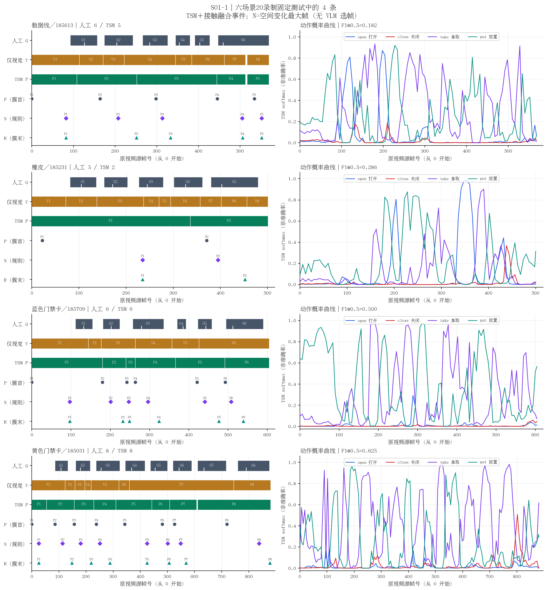
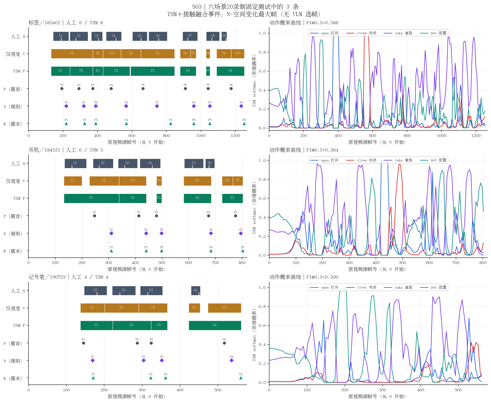
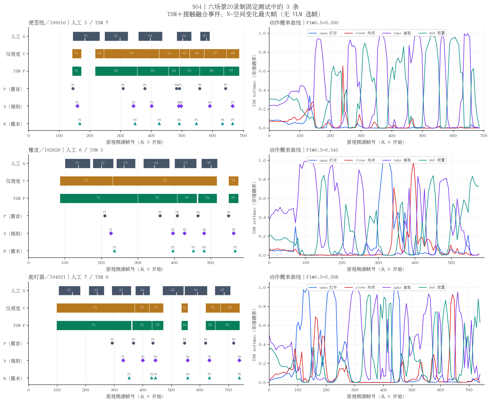
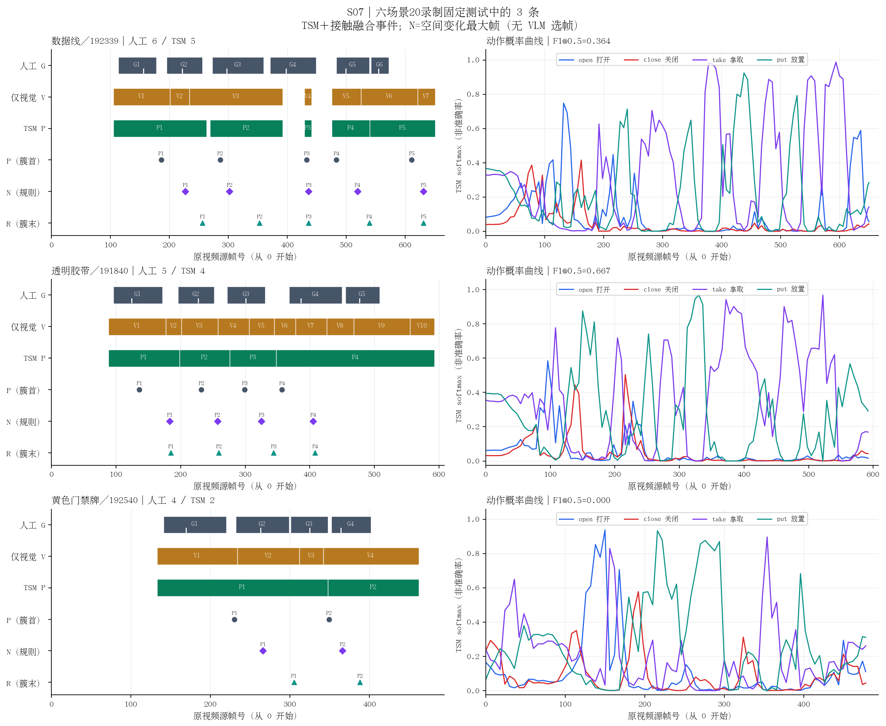
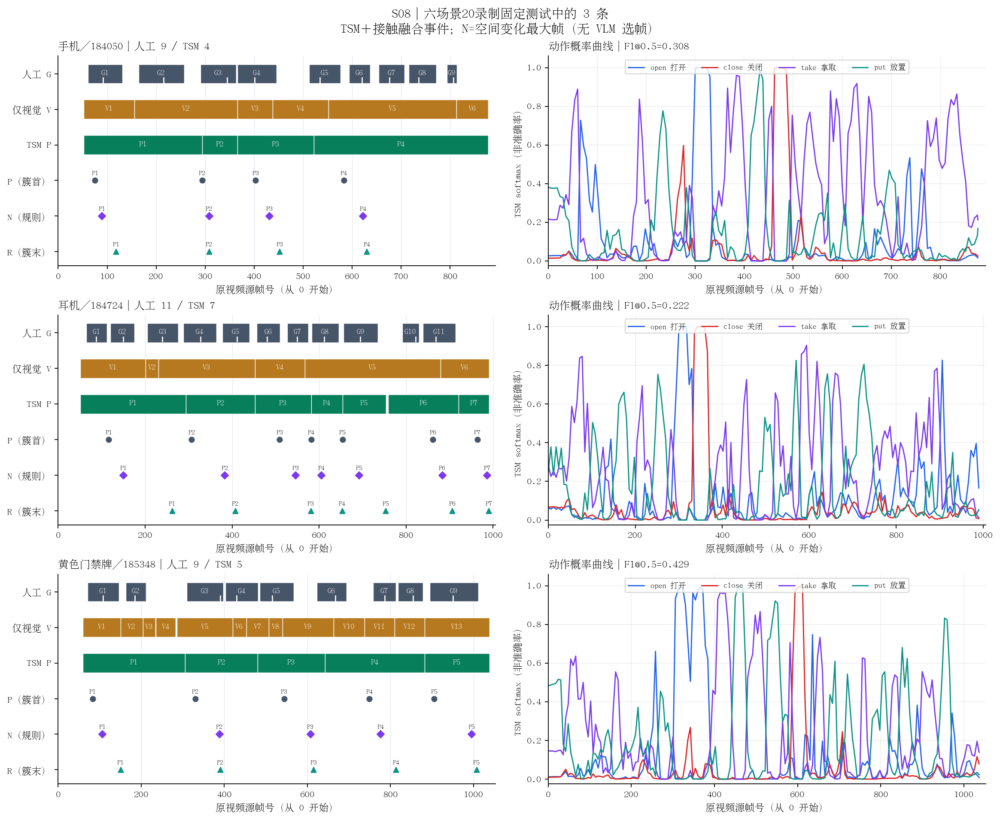
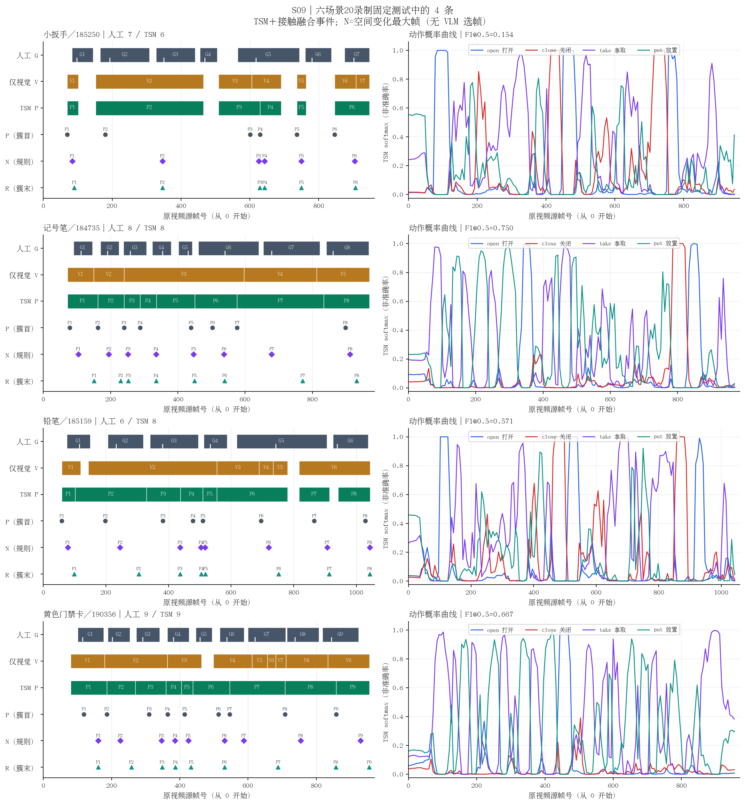

# 六场景20录制固定测试：动作概率曲线版

绘图日期：2026-11-19。原始批次：`holdout_twenty_six_scene_v1`，分层抽样 seed=20261117。

这份图对应多场景固定测试，而非三条历史开发/回归录制。全部 20 条来自 S01-1、S03、S04、S07、S08、S09；共 136 个人工事件、114 个 TSM＋接触融合预测事件。

实际归档流程为 **TSM＋接触融合/规则切分 → 接触簇端点 P/R → 空间变化最大帧 N**。该批 `sol_review_used=false`，全部三帧选择器 `vlm_used=false`、`model_calls=0`，不能标作 Qwen 27B 或 Sol 选帧结果。

## 原始指标

主门槛在原 manifest 中预先固定为 tIoU≥0.5，0.3/0.7 为辅助门槛。

| tIoU 门槛 | 匹配/预测/人工 | Precision | Recall | F1 |
| --- | --- | --- | --- | --- |
| 0.3 | 81/114/136 | 0.711 | 0.596 | 0.648 |
| 0.5 | 56/114/136 | 0.491 | 0.412 | 0.448 |
| 0.7 | 28/114/136 | 0.246 | 0.206 | 0.224 |

其中约 0.71 是宽松门槛下的 Precision，不是总体准确率，也不是 F1=0.9。先前 0.929 的三条开发/回归批次见 [历史高分图](../historical-high-score/README.md)，两批数据与评价范围不同。

## 六个场景总览

每个场景覆盖该场景的全部录制。左侧为人工区间、仅视觉基线、TSM 预测及规则 P/N/R；右侧为实际 TSM 的 open/close/take/put 概率折线，未平滑或重跑模型。

### S01-1（4 条）



[该场景 PDF](scenes/S01-1-event-action-overview.pdf)

### S03（3 条）



[该场景 PDF](scenes/S03-event-action-overview.pdf)

### S04（3 条）



[该场景 PDF](scenes/S04-event-action-overview.pdf)

### S07（3 条）



[该场景 PDF](scenes/S07-event-action-overview.pdf)

### S08（3 条）



[该场景 PDF](scenes/S08-event-action-overview.pdf)

### S09（4 条）



[该场景 PDF](scenes/S09-event-action-overview.pdf)

## 全部20条明细

| 场景 | 目标 | 录制 | 人工/预测 | F1@0.3 | F1@0.5 | F1@0.7 | 曲线详情 |
| --- | --- | --- | --- | --- | --- | --- | --- |
| S01-1 | 数据线 | 185613 | 6/5 | 0.545 | 0.182 | 0.000 | [PNG](recordings/S01-1-185613.png) / [PDF](recordings/S01-1-185613.pdf) |
| S01-1 | 橡皮 | 185231 | 5/2 | 0.286 | 0.286 | 0.000 | [PNG](recordings/S01-1-185231.png) / [PDF](recordings/S01-1-185231.pdf) |
| S01-1 | 蓝色门禁卡 | 185709 | 6/6 | 0.500 | 0.500 | 0.333 | [PNG](recordings/S01-1-185709.png) / [PDF](recordings/S01-1-185709.pdf) |
| S01-1 | 黄色门禁卡 | 185031 | 8/8 | 0.875 | 0.625 | 0.375 | [PNG](recordings/S01-1-185031.png) / [PDF](recordings/S01-1-185031.pdf) |
| S03 | 标签 | 185401 | 9/8 | 0.706 | 0.588 | 0.471 | [PNG](recordings/S03-185401.png) / [PDF](recordings/S03-185401.pdf) |
| S03 | 耳机 | 184551 | 6/5 | 0.545 | 0.364 | 0.000 | [PNG](recordings/S03-184551.png) / [PDF](recordings/S03-184551.pdf) |
| S03 | 记号笔 | 190723 | 4/4 | 0.750 | 0.500 | 0.250 | [PNG](recordings/S03-190723.png) / [PDF](recordings/S03-190723.pdf) |
| S04 | 便签纸 | 193016 | 5/7 | 0.833 | 0.500 | 0.167 | [PNG](recordings/S04-193016.png) / [PDF](recordings/S04-193016.pdf) |
| S04 | 橡皮 | 192826 | 6/5 | 0.727 | 0.545 | 0.364 | [PNG](recordings/S04-192826.png) / [PDF](recordings/S04-192826.pdf) |
| S04 | 起钉器 | 194021 | 7/6 | 0.308 | 0.308 | 0.154 | [PNG](recordings/S04-194021.png) / [PDF](recordings/S04-194021.pdf) |
| S07 | 数据线 | 192339 | 6/5 | 0.545 | 0.364 | 0.364 | [PNG](recordings/S07-192339.png) / [PDF](recordings/S07-192339.pdf) |
| S07 | 透明胶带 | 191840 | 5/4 | 0.889 | 0.667 | 0.222 | [PNG](recordings/S07-191840.png) / [PDF](recordings/S07-191840.pdf) |
| S07 | 黄色门禁牌 | 192540 | 4/2 | 0.667 | 0.000 | 0.000 | [PNG](recordings/S07-192540.png) / [PDF](recordings/S07-192540.pdf) |
| S08 | 手机 | 184050 | 9/4 | 0.462 | 0.308 | 0.154 | [PNG](recordings/S08-184050.png) / [PDF](recordings/S08-184050.pdf) |
| S08 | 耳机 | 184724 | 11/7 | 0.556 | 0.222 | 0.222 | [PNG](recordings/S08-184724.png) / [PDF](recordings/S08-184724.pdf) |
| S08 | 黄色门禁牌 | 185348 | 9/5 | 0.571 | 0.429 | 0.143 | [PNG](recordings/S08-185348.png) / [PDF](recordings/S08-185348.pdf) |
| S09 | 小扳手 | 185250 | 7/6 | 0.462 | 0.154 | 0.154 | [PNG](recordings/S09-185250.png) / [PDF](recordings/S09-185250.pdf) |
| S09 | 记号笔 | 184735 | 8/8 | 0.875 | 0.750 | 0.250 | [PNG](recordings/S09-184735.png) / [PDF](recordings/S09-184735.pdf) |
| S09 | 铅笔 | 185159 | 6/8 | 0.714 | 0.571 | 0.143 | [PNG](recordings/S09-185159.png) / [PDF](recordings/S09-185159.pdf) |
| S09 | 黄色门禁卡 | 190356 | 9/9 | 0.889 | 0.667 | 0.333 | [PNG](recordings/S09-190356.png) / [PDF](recordings/S09-190356.pdf) |

## 曲线与证据的含义

- 四条彩色曲线是分类 softmax，不是动作类别准确率，也不是事件正确概率；没有新增人工动作类别真值。未显示的其余动词类别仍可能占有概率。
- 单条详情的底部为检测到手/物体接触的二值输出，不是人工接触真值。检测处理失败画为空缺；检测不到手不直接等于确认松手。
- 三帧依旧按原规则，N 允许与 P/R 重合；完整三帧输出率不等于三张不同图或语义充分性准确率。
- 原批次按六场景分层随机、每场景物体不重复，预测先冻结后评估；没有用本次绘图调整参数或替换表现不佳的样本。
- 图中仅视觉基线与 TSM 融合来自相同录制的两份原预测；未将仅视觉基线标作 TSM v1。
- 本次复核原抽样 manifest、人工标注、事件/三帧摘要以及动作 manifest 哈希；重新计算全部原匹配对的闭区间 tIoU，汇总 81/56/28 对与原报告一致。

## 下载与复现

- [六场景总览 PDF（6页）](all-scenes-overview.pdf)
- [20条完整曲线详情 PDF（20页）](all-recordings-detail.pdf)
- [逐录制指标 CSV](recording-metrics.csv)
- [114组三帧 CSV](event-triplets.csv)
- [完整绘图数据和输入哈希](comparison.json)

原结果目录：`/home/user/zl/pipeline/runs/pnr/holdout_twenty_six_scene_v1`。

```bash
python3 scripts/plot_multiscene_holdout.py \
  --source /home/user/zl/pipeline/runs/pnr/holdout_twenty_six_scene_v1 \
  --output docs/multiscene-holdout-curves
```
