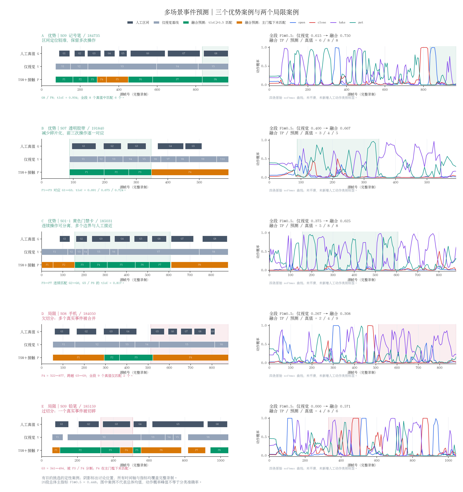

# 多场景代表案例：优势与局限

从固定的六场景20段测试中，有目的挑选三个优势案例及两个局限案例用于定性说明。没有重新选择测试集、调整门槛、重跑模型或更换预测。主门槛统一为 tIoU≥0.5，所有指标均按完整录制计算。

## 推荐展示方式

正文用前三个案例展示方法能力，并保留后两个案例解释边界；全量结果链接保留供核查。图中人工区间、仅视觉基线、融合预测逐行对齐，右侧展示原始动作概率折线，阴影圈出讨论区间。



| 案例 | 场景 / 目标 | 可说明的能力或局限 | 全段 TP/预测/真值 | 仅视觉 F1@0.5 | 融合 F1@0.5 |
| --- | --- | --- | --- | --- | --- |
| A | S09 / 记号笔（184735） | 区间定位较准，保留多次操作 | 6/8/8 | 0.615 | 0.750 |
| B | S07 / 透明胶带（191840） | 减少碎片化，前三次操作逐一对应 | 3/4/5 | 0.400 | 0.667 |
| C | S01-1 / 黄色门禁卡（185031） | 连续操作可分离，多个边界与人工接近 | 5/8/8 | 0.375 | 0.625 |
| D | S08 / 手机（184050） | 欠切分：多个真实事件被合并 | 2/4/9 | 0.267 | 0.308 |
| E | S09 / 铅笔（185159） | 过切分：一个真实事件被切碎 | 4/8/6 | 0.000 | 0.571 |

## 图中应强调的位置

- **A：**G8 / P8：tIoU = 0.934；全段 8 个真值中匹配 6 个。
- **B：**P1–P3 对应 G1–G3：tIoU = 0.691 / 0.675 / 0.724。
- **C：**P3–P7 连续匹配 G2–G6；G5 / P6 的 tIoU = 0.817。
- **D：**P4 = 522–877，跨越 G5–G9；全段 9 个真值仅匹配 2 个。
- **E：**G3 = 341–494，被 P3 / P4 分割；P4 在主门槛下未匹配。

## 解释范围

这些图支持事件分段与时间定位的定性分析。前三个案例的融合 F1 均高于相同录制的仅视觉基线；后两个案例显示提升后仍存在的合并或切碎问题。仅凭这些曲线不能认定动作分类、PNR 语义或充分性计算已准确。

绿色/橙色仅表示统一一对一事件匹配下是否达到 tIoU≥0.5，橙色不等于没有发生动作。右侧 softmax 为模型输出，没有人工动作类别真值，不报告动作准确率。该历史20段批次采用规则选三帧，没有 VLM 选帧；本图省略三帧标记以集中展示事件与动作线索。

20段总体 F1@0.5=0.448（辅助 F1@0.3=0.648），不可用精选案例代替总体性能。[全部20段结果](../multiscene-holdout-curves/README.md)。

## 下载

- [三页 PDF：合图、优势、局限](representative-cases.pdf)
- [优势图 PNG](strengths.png) / [PDF](strengths.pdf)
- [局限图 PNG](limitations.png) / [PDF](limitations.pdf)
- [案例选择、输入哈希和原始匹配指标](selection.json)

```bash
python3 scripts/plot_representative_cases.py
```
