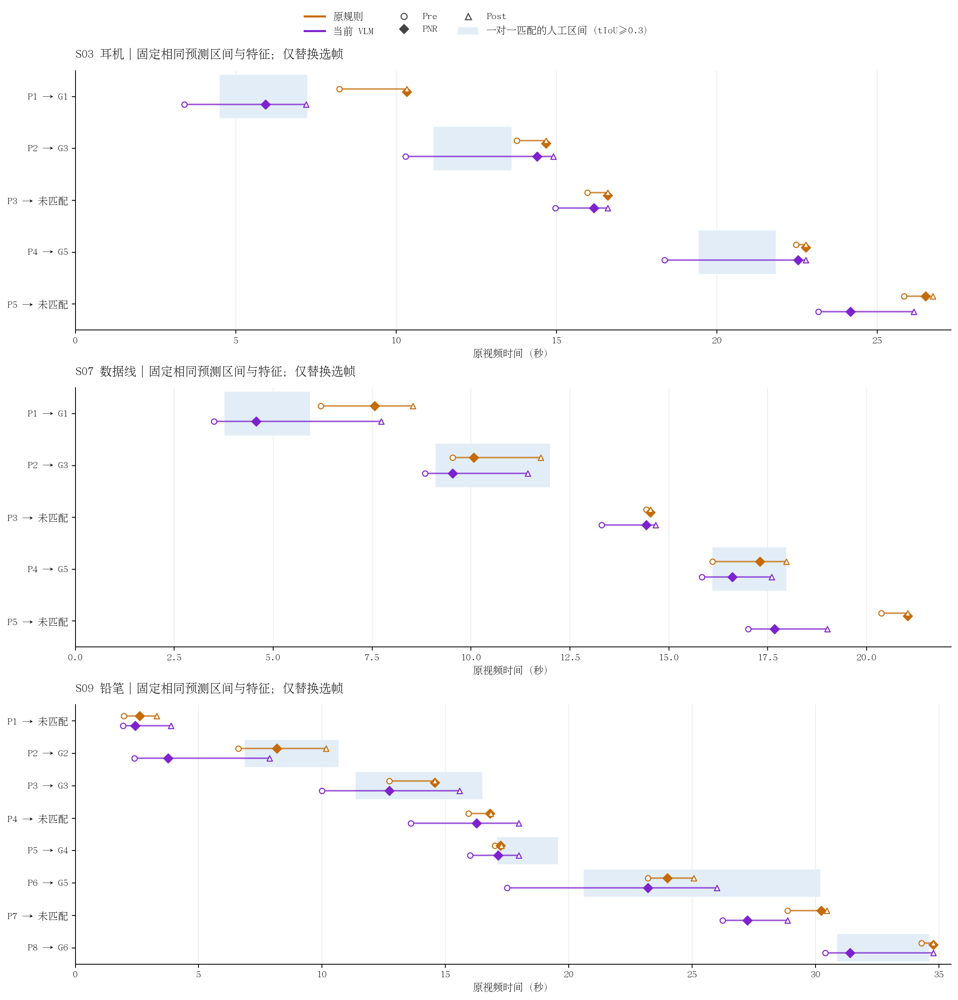

# 原规则重新选帧 vs 当前 Qwen 三帧（2026-11-18）

实际调用原 `pnr select` 处理本次 v4 的全部 18 个事件，不是只读取旧历史选帧表。共享当前检测、接触簇和所有逐帧空间变化分数，不重新切分事件、不重新调用 VLM。18 个命令均成功，规则选择器模型调用为 0。

## 控制条件与角色定义

- 原规则：Pre=有效接触簇首帧，Post=簇末帧，PNR=全部有效簇帧中空间变化分数最大者；同分取较早帧，允许 PNR 与端点重合。严格照旧实现，没有强行改成三张不同帧。
- 当前 VLM：复用 Qwen3-VL-8B-Instruct 的原始最终结果，从事件与前后文候选中选择语义 Pre/PNR/Post，要求严格递增。
- 两者共享事件、检测、簇与特征；搜索范围与角色约束存在上述差别，所以这是实际方法对照，不是完全等搜索空间的模型消融。
- 原规则的三个源帧在当前 VLM 实际展示集合中均可找到的事件数为 18/18；VLM 并非没有看到这些规则候选。
- 事件切分在选帧之前完成，因此两种选帧的切分 F1 都仍为 0.611@0.3、0.444@0.5，不能用这些 F1 判断选帧谁更好。

## 时间诊断（不是语义准确率）

| 全部 18 个预测事件 | 原规则 | 当前 VLM |
| --- | --- | --- |
| 产出三个角色引用 | 18/18 | 18/18 |
| 三个不同源帧 | 10/18 | 18/18 |
| 三个帧均在预测事件内 | 18/18 | 2/18 |
| PNR 在预测事件内 | 18/18 | 17/18 |
| PNR 与某个端点重合 | 8/18 | 0/18 |

规则在预测区间内是搜索范围约束的结果；VLM 允许使用前后文。该表不能把越出预测边界自动判为错误，也不能把区间内自动判为语义正确。

| 固定事件匹配门槛 | 诊断项 | 原规则 | 当前 VLM |
| --- | --- | --- | --- |
| 0.3 | Pre 在匹配人工区间内 | 5/11 | 0/11 |
| 0.3 | PNR 在匹配人工区间内 | 6/11 | 8/11 |
| 0.3 | Post 在匹配人工区间内 | 5/11 | 7/11 |
| 0.3 | 三帧均在匹配人工区间内 | 3/11 | 0/11 |
| 0.5 | Pre 在匹配人工区间内 | 4/8 | 0/8 |
| 0.5 | PNR 在匹配人工区间内 | 5/8 | 5/8 |
| 0.5 | Post 在匹配人工区间内 | 4/8 | 5/8 |
| 0.5 | 三帧均在匹配人工区间内 | 2/8 | 0/8 |

人工开始/结束是搜索事件范围，人工进行帧只是过程采样，缺少可接受 PNR 区间及三帧语义裁决。上述包含关系不能当作 PNR 最优率或证据充分率。



## 逐事件结果

本批 VLM 的 PNR 在 18/18 组中比规则更早，平均提前 1.64 秒，中位提前 0.75 秒。规则偏向累计变化最大时刻，VLM 的时刻更早；这项差异本身不能判定哪一帧语义更优。

G 为原人工事件编号；“N归属”仅按时间判断。匹配使用上次同一份一对一 tIoU≥0.3 结果。

| 录制/事件 | 预测区间 | 匹配人工 | 原规则 Pre/N/Post | 原规则 N归属 | VLM Pre/N/Post | VLM N归属 |
| --- | --- | --- | --- | --- | --- | --- |
| S03 P1 | 132–338 | G1 | 247/310/310 | G2 | 102/178/216 | G1 |
| S03 P2 | 339–440 | G3 | 413/440/440 | G4 | 309/432/447 | G4 |
| S03 P3 | 479–498 | 未匹配 | 479/498/498 | 人工区间外 | 449/485/498 | G4 |
| S03 P4 | 581–683 | G5 | 674/683/683 | G6 | 551/676/683 | G6 |
| S03 P5 | 725–802 | 未匹配 | 775/795/802 | 人工区间外 | 695/725/784 | 人工区间外 |
| S07 P1 | 105–262 | G1 | 186/227/256 | G2 | 105/137/232 | G1 |
| S07 P2 | 269–391 | G3 | 286/302/353 | G3 | 265/286/343 | G3 |
| S07 P3 | 429–440 | 未匹配 | 433/436/436 | G4 | 399/433/440 | G4 |
| S07 P4 | 475–539 | G5 | 483/519/539 | G5 | 475/498/528 | G5 |
| S07 P5 | 540–650 | 未匹配 | 611/631/631 | 人工区间外 | 510/530/570 | G5 |
| S09 P1 | 59–101 | 未匹配 | 59/78/99 | G1 | 58/73/116 | 人工区间外 |
| S09 P2 | 102–329 | G2 | 198/245/305 | G2 | 72/113/236 | G1 |
| S09 P3 | 330–437 | G3 | 382/437/437 | G3 | 300/382/467 | G3 |
| S09 P4 | 438–509 | 未匹配 | 478/504/505 | 人工区间外 | 408/488/539 | G3 |
| S09 P5 | 510–554 | G4 | 510/517/518 | G4 | 480/514/539 | G4 |
| S09 P6 | 555–780 | G5 | 696/720/752 | G5 | 525/696/780 | G5 |
| S09 P7 | 817–914 | 未匹配 | 866/907/914 | 人工区间外 | 787/817/866 | G5 |
| S09 P8 | 942–1043 | G6 | 1029/1043/1043 | 人工区间外 | 912/942/1043 | G6 |

## 如何解读

- 规则把三帧收在同一接触簇内，时间上更集中；当前 VLM 的自由前后文会扩展跨度，可能跨相邻人工事件。
- 结果混合：tIoU≥0.3 时，PNR 在对应人工区间内为规则 6/11、VLM 8/11；tIoU≥0.5 时均为 5/8。因此不能判定规则全面优于 VLM，也没有证据表明当前 VLM 在三帧语义上具有明确整体优势。
- S09 P2：规则为 198/245/305，N=245 属于匹配的 G2；VLM 为 72/113/236，N=113 属于前一个 G1，是当前 VLM 更差的时间归属例。
- S03 P1：规则为 247/310/310，三帧指向 G2；VLM 为 102/178/216，N=178 指向匹配的 G1。上游 P1 原本合并 G1/G2，不能靠选帧修复这个合并。
- 原图对照可直接看到：S09 P2 的规则三帧集中在抽屉内部物品操作，VLM 将较早的开抽屉过程与后面的内部操作放在一组；S03 P1 的规则主要展示笔记本电脑附近操作，而 VLM 展示枕头移开过程。这些是案例观察，没有作为盲评标签或语义准确率。
- 原规则允许 N=Post，得到的可能只有两张不同图；“更稳定”不等于三种语义角色都充分。
- 本次只重跑选帧，未为规则三帧重算 q 或累计记忆，未把 VLM 原 q 当作规则结果。未自动切换生产管线的默认选帧。

## 文件与复现

- [18 组帧号 CSV](triplets.csv)
- [完整指标与来源哈希](comparison.json)
- [时间轴 PDF](rule-vlm-triplets.pdf)
- 全部 18 组实际左目原图对照留在本机：`/data/storage/peekaboo-runs/rule_vs_vlm_20261118_v2/gallery.html`；逐事件图片在 `contact_sheets/`，未发布原视频截图。

```bash
python3 scripts/run_legacy_rule.py \
  --run-root /data/storage/peekaboo-runs/full_numeric_20261118_v4 \
  --legacy-root /home/user/zl/pipeline \
  --legacy-python /home/user/zl/pipeline/.venv-pnr/bin/python \
  --output /path/to/new_rule_run
python3 scripts/compare_rule_vlm.py \
  --reference docs/event-comparison/comparison.json \
  --selections /path/to/new_rule_run \
  --output docs/rule-vs-vlm
```
