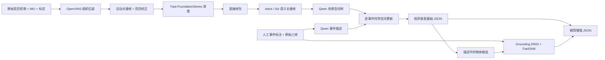

# EgoMemory Annotation Pipeline

从原始第一人称双目视频、IMU 和标定，逐步生成带场景空间关系、事件三帧描述、时序父关系和二维物体锚点的 JSON。

本仓库整理自实际使用的处理工程，保留其主要算法与字段契约，并增加可迁移路径、显式输入清单、统一入口和合成测试。历史交付包含 320 条、2,237 个事件、6,711 张事件图像；该数量是已有数据的记录，不代表本仓库附带这些数据。

2026-11-12 已使用一条真实录制及其人工三帧运行全部阶段，最终精简 JSON 通过同一 Schema、核心字段及三帧对应校验。该样本的 VIO 质量告警和实跑中修复的问题见 [单条真实验证](docs/REAL_SAMPLE_VALIDATION.md)；这不是全数据集或新机器的质量保证。

## 处理流程



- OpenVINS 提供相机位姿；场景物体之间的语义空间关系来自视觉模型。
- 搜索事件三帧来自已有人工标注，过程帧不要求是起止帧的中点。
- 锚点只覆盖事件描述明确提到的对象，包括明确提及的背景物体。
- `size_wh_normalized` 是二维检测框相对宽高；原字段和值在增强时保留。
- 结构和来源完整性校验不等于人工语义验收。

## 文档

| 文档 | 内容 |
|---|---|
| [完整 Pipeline](docs/PIPELINE.md) | 原始采集到最终 JSON 的逐步说明、模型职责、真实历史样例和版本差异 |
| [安装与外部资源](docs/INSTALL.md) | Python / ROS / OpenVINS、GPU 模型和服务配置 |
| [运行指南](docs/RUNNING.md) | 统一入口、输入清单、分阶段运行、恢复和校验 |
| [数据格式](docs/DATA_FORMAT.md) | 原始录制、三帧命名、时间和坐标、输出字段 |
| [锚点详细流程](docs/ANCHOR_PIPELINE.md) | 描述候选、检测、分割、冲突和导出 |
| [精简格式](docs/COMPACT_JSON.md) | object_anchors、size 和审计证据 |
| [迁移与验证记录](docs/PORTABILITY.md) | 代码来源、便携修改、测试范围和限制 |
| [单条真实验证](docs/REAL_SAMPLE_VALIDATION.md) | 实际模型运行、字段对照、修复和轨迹质量限制 |
| [上传 GitHub](docs/GITHUB.md) | 将本地仓库上传到自己的 GitHub |
| [组件来源](THIRD_PARTY_NOTICES.md) | 上游代码、外部依赖和保留的许可声明 |

## 先运行不依赖模型的示例

Linux / Python 3.12：

```bash
python3 -m venv .venv
source .venv/bin/activate
pip install -r requirements.txt
python scripts/check_repository.py
python scripts/pipeline.py doctor
python scripts/make_demo.py --output runs/synthetic-demo
pytest -q
```

示例生成三张人工绘制图片和一个符合上游 schema 的 JSON，并明确记录 `synthetic_test_fixture_no_model_calls`。它用于验证装配和格式，没有执行 OpenVINS 或真实模型推理。测试中的模型调用为显式 mock。

完整处理入口：

```bash
# 先按安装和运行指南填写自己的模型、服务和数据配置。
python scripts/pipeline.py prepare --manifest configs/pipeline.local.json --output runs/annotation
python scripts/pipeline.py annotate check --config runs/annotation/pipeline.json
python scripts/pipeline.py annotate run --config runs/annotation/pipeline.json
python scripts/pipeline.py annotate validate --config runs/annotation/pipeline.json

python scripts/pipeline.py anchors-prepare --sources configs/anchor_sources.local.json --models configs/anchor_models.local.json --output runs/anchors
python scripts/pipeline.py anchors-run --root runs/anchors
python scripts/pipeline.py anchors-validate --root runs/anchors
```

`prepare` 核对标注清单并生成配置；真正的视频内容审计和推理发生在 `annotate run`。已有基础 JSON 可以直接进入 anchors 阶段。

## 目录

```text
components/
  preprocessing/     OpenVINS 回放、运动选帧、双目校正、深度
  semantic/          筛帧、场景、事件、时序推理和 prompts/schema
  annotation/        pipeline115 调度、直接帧包、审计和装配
  additive/          研究字段、时序关系链接和输出视图
  anchors/           候选词表、Grounding DINO、FastSAM、精简导出
configs/             无密钥的配置模板
scripts/             统一命令、合成示例、仓库检查
provenance/          来源哈希、外部资源版本、验证记录
patches/             本机 OpenVINS ROS 兼容修改
```

原始视频、真实标注 JSON、模型权重、服务密钥和历史运行日志不随源码发布。`.gitignore` 排除数据、权重、`runs/`、本地配置和密钥文件。仓库没有声明一份覆盖所有组件的新许可证，已有第三方声明原样保留，详见组件来源文件。
