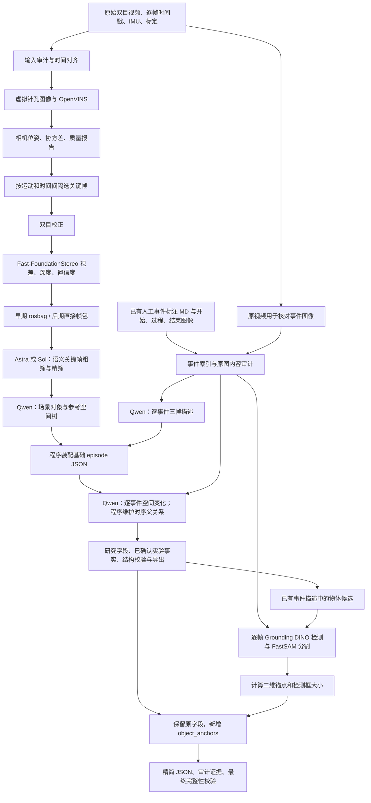

> 发布版说明：`<DATA_ROOT>`、`<OUTPUT_ROOT>`、`<MODEL_ROOT>` 是本地资源占位符；历史运行数字保留。新仓库的可执行入口以 [运行指南](RUNNING.md) 为准，历史命令用于解释来源。

# 从原始采集到最终标注 JSON 的完整 Pipeline

核对日期：2026-11-12。本文依据本机实际运行代码、批次说明、单条过程文件及最终交付校验报告整理。

本文说明一条原始双目视频和 IMU 数据，如何经过 OpenVINS、运动关键帧、双目深度、语义关键帧、场景空间关系、事件三帧描述、时序关系更新，最终成为带逐帧物体锚点的 JSON。各历史批次有版本差异，以下以 11-5 的 72 条和 138 条流程为详细主线，并明确早期版本与后续增强的区别。

当前交付共 320 条、2,237 个搜索事件、6,711 张事件图像。它们复用了不同历史版本的上游标注，再统一进行锚点增强，并未全部重跑同一版上游流程。

## 1. 全流程与两条输入支路



这里有三种不同的“帧”，不能混用：

| 类型 | 由谁决定 | 用途 |
|---|---|---|
| 运动关键帧 | 程序根据 OpenVINS 位姿变化与时间间隔筛选 | 减少冗余，保留有位姿的视角，供校正和深度处理 |
| 语义关键帧 | Astra / Sol 看运动关键帧拼图及高清候选后选择 | 用少量互补视角描述整个场景的物体与层级 |
| 搜索事件三帧 | 已有人工标注资料中的开始、过程、结束帧 | 描述每次搜索及三时刻的物体、动作、遮挡和空间变化 |

事件三帧不是从最终那几张语义关键帧中再抽出来的。`middle` 是标注者选择的过程帧，不要求等于起止帧的算术中点。上游预处理使用左右图；本次事件描述与最后的锚点定位使用 JSON 引用的事件左图。

## 2. 第一步：登记最原始的数据

每条录制的典型目录为：

```text
<episode>/
  videos/left.mkv
  videos/right.mkv
  timestamps/left_timestamps.txt
  timestamps/right_timestamps.txt
  imu/imu0.csv
  calibrations/camera-camchain.yaml
  calibrations/camera_imu-camchain-imucam.yaml
  calibrations/camera_imu-imu.yaml
  meta.json
```

视频提供左右目原始画面；时间戳提供每帧的采集时刻；IMU 提供惯性测量；标定文件提供双目内外参、相机与 IMU 的外参和时间偏移。文件名、episode ID、来源批次和文件哈希共同确定输入身份。

另有独立的人工标注资料：目标物体说明、`*_三帧.md`、三帧图片，以及部分批次的初始照片和实验位置记录。先解析这些资料建立事件索引，保留原标签和来源。相同 episode ID 在不同来源组出现时，保留来源分组，不直接按文件名覆盖。

预处理审计会顺序解码视频，核对帧数、图像尺寸和时间戳数量；将十进制秒精确转换成整数纳秒，按采集时间匹配左右帧，再检查相机—IMU 时间偏移后的 IMU 覆盖范围。未匹配帧、覆盖不足帧和原始索引都有记录。

左右图不能仅按相同数组下标配对。名义 30 FPS 也不能替代传感器时间戳。审计中的 `synchronization_status=unknown` 表示硬件同步未获确认，即使时间戳能匹配也不应改写为已验证硬件同步。

**输出：**输入哈希、可处理帧对索引、原始帧号和时间戳、审计报告。实现位于 `egomemory-core/src/daaam/preprocessing/audit.py`，绝对路径见第 16 节。

## 3. 第二步：OpenVINS 恢复相机运动

### 3.1 为 OpenVINS 准备图像和标定

采集相机使用的 DS（Double Sphere，双球）模型先映射为虚拟针孔图像，使图像和内参匹配 OpenVINS 的输入。核对的样例采用 960×600、水平视场角 100°；这是该次配置，不应当作所有批次的固定参数。相机与 IMU 的 Kalibr 外参同时保留。

程序把双目图像与 IMU 按传感器时序回放给 OpenVINS，启用动态初始化。OpenVINS 是视觉惯性状态估计算法，利用图像跟踪与惯性测量估计运动，不负责命名物体或理解搜索动作。

### 3.2 从 IMU 位姿转到每帧相机位姿

OpenVINS 的 `/ov_msckf/odomimu` 输出 IMU 位姿。程序使用相机—IMU 外参转换到相机坐标系，并用 cam0 的时间偏移对齐相机采集时刻和惯性时间轴。

需要某张相机图的位姿时，在其查询时刻两侧的有效里程计之间插值：平移线性插值，旋转使用四元数 SLERP。已核对的实现将最大插值 bracket gap 设为 50 ms；超出轨迹覆盖范围时不外推，不为没有依据的图像补位姿。协方差同时考虑相机与 IMU 之间的杠杆臂变换。

**输出：**有原始帧号和采集时间的相机位置、朝向、协方差，以及原生里程计和 `vio_acceptance.json`。

这里的位置是局部 `vio_world` 坐标系中的相机位置，并不直接给出杯子、桌子或抽屉的世界坐标。预处理公共位姿文件采用毫米及 `xyzw` 四元数；ROS / 直接帧包的 TF 平移采用米，转换时协方差也必须对应缩放。

### 3.3 轨迹质量与流程完成分开记录

`vio_acceptance.json` 检查相机位姿覆盖率、里程计间隔/速率、位置与旋转不确定度等。历史实现允许在质量报告未通过时，继续使用已有可插值位姿处理后续帧。

因此，后面的 JSON 成功生成，不代表该条 VIO 质量通过，更不代表具有经过真值验证的定位精度。第 13 节的真实样例就保留了此类异常。

## 4. 第三步：先选运动关键帧，再校正双目和计算深度

### 4.1 运动关键帧怎么选

历史预处理调用 `select_ego_keyframes.py:select_keyframes`。程序按时间顺序比较当前相机位姿和上一次保留帧，综合平移、旋转、最小时间间隔和最大时间间隔决定是否保留。首末帧也由该选择器处理。

已核对样例的参数为：

| 参数 | 数值 | 作用 |
|---|---:|---|
| 软平移阈值 | 60 mm | 移动达到一定幅度后可触发选择 |
| 硬平移阈值 | 150 mm | 大幅平移优先触发 |
| 软旋转阈值 | 5° | 视角变化达到阈值后可触发 |
| 硬旋转阈值 | 12° | 大幅旋转优先触发 |
| 最小间隔 | 0 s | 该配置不额外要求正的最短间隔 |
| 最大间隔 | 0.25 s | 在有效位姿序列内避免长时间不选帧 |

它是一层基于运动的冗余削减，没有识别“正在翻抽屉”或“找到目标”。当前脚本还含其他选择算法，但不能将后来加入的算法写成历史批次已经执行的方法。具体以 `selection_report.json` 的 selector 和 thresholds 为准。

### 4.2 双目校正

选择帧后，程序将左右原图校正到共享的针孔立体几何，输出左右校正图、相机内参、双目基线。相机姿态也同步转到校正后的 `cam0_rect` 坐标系。

校正后的图像像素系、原始事件图像像素系和世界坐标系必须区分。后续事件图上的二维锚点不能直接套用校正图的内参反投影。

### 4.3 Fast-FoundationStereo 生成深度

GPU 上的 **Fast-FoundationStereo** 读取校正后的左右图，估计视差。随后程序按：

```text
Z = fx × B / disparity
```

将视差转换成深度，其中焦距 `fx` 的单位是像素，基线 `B` 的长度单位决定深度单位。左右一致性用于生成深度置信度。

已核对样例使用 `20-30-48/model_best_bp2_serialize.pth` 权重，8 次迭代、最大视差 416 像素、Triton volume builder 和 left-right confidence。输出深度为 uint16 毫米，0 表示无效；置信度编码为 uint8 0–255，不能当作经校准的正确概率。

**输出：**运动关键帧对应的校正 RGB、深度、置信度、内参、位姿和各阶段报告。Fast-FoundationStereo 与最后做二维分割的 FastSAM 是两个不同模型。

## 5. 第四步：把几何预处理结果交给语义标注

### 5.1 早期传输：rosbag

早期 bag 主线将校正图、CameraInfo、深度、置信度、pose、TF 和原帧元数据写入 rosbag。主要 topic 包括：

```text
/preprocess/left/image_rect/compressed
/preprocess/right/image_rect/compressed
/preprocess/depth/image
/preprocess/depth/confidence
/preprocess/pose
/preprocess/frame_metadata
/tf
```

语义入口 `run_scene_event_batch.py:extract_rgb_tf` 从 bag 提取 RGB、帧元数据、TF / pose，生成帧索引。这个提取环节不重新运行 VIO，也不解码深度数据生成物体坐标。

### 5.2 11-5 主线：直接帧包

72 条和 138 条采用 `pipeline115`：CPU 完成 audit → vio → select → rectify，GPU 完成 depth，然后直接发布 `ego.direct_frames.v1`，省去 rosbag 写入和读回。

直接帧包包含 `ready.json`、`all_frames.jsonl`、`camera.json`、`vio_acceptance.json` 和供视觉模型读取的 RGB JPEG；保留原帧号、传感器纳秒时间戳、相机位姿及上游校正图、深度、置信度文件的哈希引用。该版本 JPEG 质量为 90；位姿平移由毫米转米，协方差按对应单位变换。

这类包引用外部预处理文件，并非全部资源都复制进一个自包含目录。移动交付或清理中间结果时，必须保留引用关系。

### 5.3 当前“空间信息”具体来自哪里

| 信息 | 来源 | 当前用途与限制 |
|---|---|---|
| 相机位置、朝向、不确定度 | OpenVINS + 标定转换 | 辅助视角互补选择；表示相机，不表示物体 |
| 每像素深度 | 校正双目 + Fast-FoundationStereo | 保存在几何预处理结果中；当前语义树生成没有经核实的深度反投影物体定位步骤 |
| 桌上、篮内、安装在显示器上等关系 | Qwen 看语义关键帧 | 生成带图像证据的语义空间树，仍需复核 |
| 物体父关系随事件的变化 | Qwen 看事件三帧 + 程序维护关系图 | 在采样帧上建立时序区间，不证明帧间所有变化 |
| 当前帧中物体的二维锚点与图像大小 | Grounding DINO + FastSAM + 几何规则 | 归一化图像坐标与框宽高，不是三维测量 |

当前代码证据不支持把这套流程描述成“由深度点云直接构建了带物体世界坐标的三维语义地图”。TF 表达的是 `vio_world → cam0_rect`，不是物体坐标。

## 6. 第五步：Astra / Sol 选语义关键帧

输入是运动关键帧的 RGB 及原始视频帧号。程序把所有候选组织成每张 12 格的缩略拼图，先粗筛，再提供高清候选精筛。

粗筛通常保留 6–10 帧、上限 10；精筛建议 3–4 帧、上限 6。模型优先选择能补充物体、容器内部、支撑层级及较少遮挡的视角，减少重复画面。TF 中的相机位置、光轴与协方差可作为视角差异参考。

这一步选的是“哪些画面更有利于理解场景”，不会自动生成每个搜索事件的起止边界，也不保证覆盖视频中所有物体。

早期使用 `gpt-6-astra`；72 条期间发生筛帧模型迁移；后续 138 条配置和已核对样例使用 `gpt-6.1-sol`。历史目录名 `astra_coarse`、`astra_refine` 仍保留，不能单看目录名判断实际模型。

**输出：**`candidate_manifest.json`、粗筛/精筛请求响应与 profile、`selected_frames.json`、`selected_montage.jpg` 和供 Qwen 使用的高清分条 `qwen_detail_strips`。实际模型以该条 profile、响应和运行记录为准。

## 7. 第六步：Qwen 把图像整理成场景对象与参考空间树

Qwen 读取选中的拼图与高清分条，按 schema 生成对象和空间关系。程序再校验 ID、引用和树结构，装配到 `scene_memory`。

主要内容如下：

| 内容 | 输出形式 | 例子或含义 |
|---|---|---|
| 对象档案 | `scene_memory.objects` | 稳定候选 ID、名称、类别、形状、颜色、证据帧 |
| 直接归属 | `spatial_structure.nodes[].children`，递归嵌套 | 杯子直接在桌上；物体直接在篮内 |
| 放置关系 | 节点 `placement` | `on`、`inside`、`mounted_on`、`hanging_on`、`within_region`、`unknown` |
| 相对布局 | 节点 relations / cross_level_relations | 某证据视角下位于左边、后方、旁边 |
| 不确定对象或身份 | unlocated / identity candidates 等 | 无法可靠挂接到父节点时保留不确定性 |
| 常识与用途 | commonsense / affordances 等 | 与图像直接支持的关系区分保存 |

例如“桌子 → 收纳篮 → 篮内物体”是直接父关系链。篮内物体不因为最终也受桌子支撑，就同时把桌子作为直接父节点。跨层相对关系单独表示，不改变树的直接归属。

这是一份多视角综合的**参考布局**。不同证据帧可能对应不同时间，不能把合成树当作任意时刻的完整场景快照。左右关系也受证据视角限制。模型给出的对象去重和跨视角身份尚未经过逐物体人工确认；`group_or_partial` 不能算成一个确定的独立物体。

早期代码的状态标签可能含 `local_qwen`，后期整条调度实际可由远端 Qwen 处理。判断执行端点要读 profile，不能仅凭状态字符串断定本机运行。

## 8. 第七步：独立核对每个搜索事件的三帧

### 8.1 三帧来源

已有 MD 标注提供事件顺序和开始 / 过程 / 结束帧号，对应 `start`、`middle`、`end`。例如已核对的一份早期 MD 明确采用 30 FPS、从 0 开始的帧号，并记载三次按键构成一次搜索标注。

后续流水线解析 MD 与图像建立事件索引；不会要求三帧都经过运动关键帧筛选。因此，即使某张事件图早于 OpenVINS 初始化完成，仍可以保留为事件视觉证据。

### 8.2 如何核对图片对应原视频

11-4/11-5 输入审计读取登记的原始 `left.mkv`，在标签帧附近 ±90 帧窗口内做缩略图内容匹配。已核对规则使用 160×100 图，要求相关性 ≥0.99、平均绝对误差 ≤4；同时登记文件哈希和解码情况。

原标注帧号与最佳匹配解码位置分开保存。发现偏差时记录警告，不静默修改原标签的事件时间轴。右目图片在此审计中做哈希和解码检查，没有实施同样的逐像素视频匹配，不能称左右目均通过该项匹配。

**输出：**逐事件 phase、原视频帧号、`state_id`、图像绝对路径、SHA-256、显示时间及审计证据。显示时间按原帧号 / FPS 计算；它与用于 VIO 的传感器纳秒时间是两种时间表示。

## 9. 第八步：Qwen 描述每次搜索及每帧状态

每个事件的开始、过程、结束图组成一张标有阶段、帧号、时间的横向三帧图，并提供同三张图的高清面板。两种展示形式对应同三个时刻，并不是六个时刻。

输入还包含目标物体说明和事件描述提示词；11-4/11-5 在已有提示词上加英文输出要求。Qwen 生成：

- 事件整体：`event_summary`、`observed_changes`、`search_region`。
- 逐帧状态：`state_description`、`hand_action`、`focus_object_states`、`visibility_and_occlusion`、不确定性。
- 后期扩展：`potential_search_regions`，即图像支持的可能搜索区域。

模型负责语义内容，程序负责路径、哈希、原帧号、phase 和 state ID 等确定元数据。无法从画面确定是否找到目标时保留 unknown；看不到目标不能直接推出该空间内不存在目标。

程序随后组装 `search_event_states`、事件局部实体、`search_units`、`inspections`、`episode_outcome` 和统计字段。事件实体与场景对象的同名匹配仅能作为候选联系；跨事件搜索区域的不同 ID 不意味着不同物理容器。重访身份未知时不强行合并或计数。

`potential_search_regions` 是候选区域，不代表参与者已确认的意图，也不是实际检查过区域的完整清单。

## 10. 第九步：逐事件补充时序空间变化

11-4/11-5 实际流程在完成事件描述后，**另行逐事件调用 Qwen**，输入稳定的场景对象目录、原始事件三帧和当前关系图。不能套用其他优化方案中“同一次调用直接完成全部时序标注”的说法。

模型判断被操作的已登记物体是否换了直接父节点，或在同一父节点内改变了相对位置，并返回 `spatial_changes` 与不确定性。它不只跟踪搜索目标。程序按事件顺序应用变化，关闭旧关系、开启新关系，维护 `parent_graph.json`。

边界约束如下：

1. 节点引用必须来自现有 catalog，不能凭空创造或重新编号来消除冲突。
2. `change_frame` 必须是该事件三张证据图中的帧号；边界只是采样证据，不能声称就是动作真实发生瞬间。
3. 关系区间采用 `[valid_from_frame, valid_to_frame_exclusive)`，结束边界不包含在旧关系中。
4. 搬动一个容器不自动意味着内部物体换了直接父节点。
5. 无法确认的父节点或动作保留 unknown；未列出变化也可能因为对象未进入目录或证据不足。
6. 场景参考来自混合时刻，不能把其中关系无依据回填到 frame 0；事件直接证据可用于修正当前关系判断。

中间 `temporal.json` 可包含嵌套时序树，但最终 additive 导出保留原参考树及原 placement，将时序父关系附加到**每个树节点的 `parent_relations`**，将变化附加到**事件的 `spatial_changes` 和 `spatial_change_annotation`**。查询某时刻布局，应按有效的 parent_relations 重建树，不能只遍历原 `children`。

已核对最终样例中，基础空间 schema 仍为 `ego.scene.nested_local_spatial_graph.v4`，顶层 `history` 为 `null`。不能把 `history` 描述成已经装载整段时序空间历史的字段。

## 11. 第十步：装配研究字段、确认事实和基础交付 JSON

CPU 装配流程补充研究字段、挂接时序关系、执行 schema 和引用检查，再导出基础 JSON 及实验所需视图。实验记录未知的值保留 `null`，例如参与者信息、物理容积、搜索成本、精确连续动作边界或重访确认。

部分批次根据用户已确认的实验事实生成 `confirmed_json`，例如对应清单中“前 N−1 次未找到，最后一次找到”。该类事实投影保留原视觉结论（如 `visual_outcome_before_protocol`），不能把实验事实改写成模型已经直接看见的证据。

初始照片文件名或 MD 中的实际放置位置，在适用批次通过 `dataset_location_facts` 附加并标明来源；这些作为实验事实在 CPU 阶段装配，不应作为隐藏答案混入视觉模型输入。文件名位置说明也不会自动成为某个 scene 节点 ID 或精确搬移时刻。

此时已得到后续锚点增强使用的源 JSON。11-5 样例的顶层字段包括：

```text
schema, README, metadata, scene_memory, search_event_states,
search_units, inspections, episode_outcome, derived_statistics,
history, hidden, priors
```

早期 81 条存在不同 schema 和扩展版本；保留其原内容，不能宣称 320 条都经历了同一版时序扩展，或都有完全相同的顶层字段。

## 12. 第十一步：在已有 JSON 上增加逐帧物体锚点

本阶段不重新生成场景或事件，不重新从视频选三帧。先汇总 320 条源 JSON，核对其 2,237 个事件、6,711 个图像路径与哈希，再按来源分组增强。

### 12.1 先从当前事件描述中找要定位的对象

候选来自事件总结、观察变化、搜索区域和三帧的状态描述、手部动作、遮挡描述。明确提到的桌面、显示器等背景物体也在范围内；不标注图中所有未被描述提及的物体。

一个事件的候选并集，在这个事件的三帧分别尝试定位。优先复用可安全匹配的场景/事件实体引用，否则使用事件局部 `mention:`；身体部位、抽象动作、未指明成员的杂物集合、纯假设或否定提及等按范围规则过滤。

当前 320 条版本的候选来源为：49 条本机 Qwen 提取、2 条助手整理、269 条固定中英文词表与原文匹配。续跑保留原 50 条并加入另 1 条试跑结果，余下 269 条没有调用文本模型。这里“后续不用 Qwen”仅指锚点候选阶段；上游语义标注仍使用过本机或远端 Qwen。

### 12.2 Grounding DINO + FastSAM + 程序计算

Grounding DINO Tiny 根据候选英文短语在每张图中产生检测框。FastSAM-s 对同张完整图像生成掩码候选，程序再用框 IoU、掩码位于框内的比例和匹配差值选择掩码。实际实现不是为每个 DINO 框裁图再各跑一次 FastSAM。

有可靠匹配掩码时，在最大连通区域中选离边界最远的像素中心作为锚点；没有可靠掩码或匹配歧义时使用检测框中心；完全未检出时坐标和大小为 null。各帧独立计算，不把上一帧坐标复制到下一帧。

```text
anchor_xy_normalized = [x / 原图宽, y / 原图高]
size_wh_normalized   = [检测框宽 / 原图宽, 检测框高 / 原图高]
```

`size` 是二维检测框的相对宽高，不是厘米、体积、掩码面积比例或完整物体三维大小。遮挡、透视、裁切和错检均会影响它。

### 12.3 精简导出

深拷贝源 JSON，只在 `search_event_states.events[].states[]` 中新增 `object_anchors`。每项保留五个字段：

```json
{
  "name": "blue coffee cup",
  "ref": "scene:o01",
  "anchor_xy_normalized": [0.52, 0.43],
  "size_wh_normalized": [0.13, 0.22],
  "status": "mask_unreviewed"
}
```

此例仅解释格式，不对应真实测量。状态可为 `mask_unreviewed`、`mask_needs_review`、`bbox_center_needs_review` 或 `not_detected`。掩码匹配歧义退回框中心；多实例、引用竞争等冲突保留复核标记。`not_detected` 只表示模型未检出。

检测分数、候选原文证据、掩码、框、冲突原因、叠加图和处理记录保留在详细审计目录，精简 JSON 不承载这些额外内容。导出检查移除新增字段后，必须与源 JSON 的原字段和值完全一致。

具体阈值、模型路径、批处理机制、断点与审计文件见 [锚点阶段详细 Pipeline](ANCHOR_PIPELINE.md) 和 [精简 JSON 规范](COMPACT_JSON.md)。

## 13. 用一条实际数据走完整流程

样例为 `cs_0001_session_20261030_190346`，来自 138 条中的 11.2，目标是黄色门禁卡。以下数字取自该条过程文件，不是全批次的平均值。

| 环节 | 真实记录 |
|---|---|
| 原始视频 | 左 525 帧，右 526 帧，1920×1200 |
| 输入审计 | 525 个精确时间戳配对，IMU 覆盖后 eligible 523 对；原始 IMU 6,544 条 |
| OpenVINS | 原生里程计 2,584 条；385 张相机图可插值到位姿，覆盖率约 73.61% |
| VIO 质量 | `passed=false`，覆盖率和位置不确定度检查未过；最大位置标准差约 1.427 m |
| 进程记录 | OpenVINS 退出码 `-11`；后续仍使用已产出的可用位姿，不能写成正常无异常完成 |
| 运动关键帧 | 385 张有位姿帧中选 264 张，所选首帧 f140 |
| 校正和深度 | 264 张，960×600，双目基线约 99.723 mm |
| 语义关键帧 | Sol 选 f140、f287、f354、f425，共 4 张 |
| 场景标注 | 21 个对象候选，不等于人工确认的 21 个独立物体 |
| 事件三帧 | 4 个事件、12 张图，详见下表 |
| 语义端点 | scene / events / temporal 的 profile 均为远端 `qwen3.8-27b`、Q8_0、16,384 context |
| 最终增强 | 基于原 confirmed JSON 的 12 个 state 分别增加 object_anchors |

| 事件 | start | middle | end |
|---|---:|---:|---:|
| 1 | 112 | 142 | 191 |
| 2 | 207 | 232 | 257 |
| 3 | 299 | 317 | 372 |
| 4 | 396 | 419 | 523 |

事件 1 的 f112 早于运动关键帧首帧 f140，直观说明两条输入支路独立。事件 4 的过程帧 f419 也不是 f396 与 f523 的算术中点。

核对路径：

- 原始录制：`<DATA_ROOT>/11-5标注/11.2/baai_ego_task/cs_0001_session_20261030_190346/`
- 事件 MD：`<DATA_ROOT>/11-5标注/11.2/标注数据/S01-1/黄色门禁卡/cs_0001_session_20261030_190346/cs_0001_session_20261030_190346_三帧.md`
- 预处理：`<DATA_ROOT>/11.5/followup138_20261105/11.2/run001/preprocessed/cs_0001_session_20261030_190346/`
- 逐阶段语义证据：`<DATA_ROOT>/11.5/followup138_20261105/11.2/run001/annotations/episodes/cs_0001_session_20261030_190346/`
- 增强前 JSON：`<DATA_ROOT>/11.5/followup138_20261105/11.2/run001/annotations/confirmed_json/cs_0001_session_20261030_190346.json`
- 最终 JSON：`<OUTPUT_ROOT>/frame_anchor_batch_20261110_resume50/json/followup138/11.2/cs_0001_session_20261030_190346.json`

查看过程目录中的 `input/vio_acceptance.json`、`selection/selected_frames.json`、各阶段 profile、`visual_source.json`、`parent_graph.json`、`temporal.json` 和 `complete.json`，可以逐步对照产物。目录和状态中沿用的 Astra/local 字样不覆盖 profile 的实际执行记录。

## 14. 模型与程序职责对照

以下是项目实际记录中的名称，不表示外部产品版本或当前服务状态。

| 组件 | 输入 | 本项目负责的工作 | 不据此确认的内容 |
|---|---|---|---|
| OpenVINS | 双目图、IMU、标定 | 相机/IMU 运动估计及不确定度 | 物体类别、物体世界位置、搜索事件 |
| Fast-FoundationStereo | 校正双目图 | 视差、深度；配合程序计算一致性置信度 | 物体语义及最终锚点 |
| gpt-6-astra / gpt-6.1-sol | 候选拼图、高清图、视角参考 | 语义关键帧粗筛与精筛 | 人工搜索事件边界、物体公制坐标 |
| 本机 Qwen3.8-27B，记录配置含 Q4_K_M | 场景关键帧、事件图和任务提示 | 依阶段/整条分工完成场景、事件、时序语义；部分历史锚点文本候选 | 人工验收或无误的跨帧身份 |
| 远端 qwen3.8-27b，记录配置含 Q8_0 | 同上，由运行路由决定 | 上游事件；后期也可承接整条场景、事件、时序 | 不能以旧 routes 推断每条实际分工 |
| Grounding DINO Tiny | 事件图 + 候选文字 | 对描述提及的对象给出检测框 | 可靠三维位置、永久身份 |
| FastSAM-s | 单帧完整图像 | 产生分割掩码候选 | 自行决定本事件应标注哪些物体 |
| CPU 规则和装配代码 | 上述结果、索引、证据、实验事实 | 时间/引用/树维护、二维计算、原值保留、导出和校验 | 不把结构通过升级为语义正确 |

早期 11-5 文档曾记录“本机做场景/时序、远端做事件”的阶段路由，后来增加整条 episode 分配。远端上下文也有 8,192 和后续 16,384 的不同记录；应以每条执行 profile 为准，不能统一套用旧配置。本文不包含服务密钥。

## 15. 历史批次、最终目录与验证边界

### 15.1 320 条如何组成

| 来源分组 | JSON 数 | 事件数 | 三帧图像数 |
|---|---:|---:|---:|
| initial81/base68 | 68 | 401 | 1,203 |
| initial81/nightstand13 | 13 | 133 | 399 |
| followup29 | 29 | 196 | 588 |
| remaining72 | 72 | 458 | 1,374 |
| followup138/11.2 | 60 | 379 | 1,137 |
| followup138/11.3 | 71 | 626 | 1,878 |
| followup138/input7_11.2 | 3 | 16 | 48 |
| followup138/input7_11.3 | 4 | 28 | 84 |
| **合计** | **320** | **2,237** | **6,711** |

81 = 68 + 13；138 = 60 + 71 + 3 + 4。早期登记的 7 条输入跳过后来按用户要求补做，已包含在当前 320 条中，不能再从最终结果中扣掉 7 条。18 条修复和这 7 条补做也不能另加成 25 条新样本重复计数。

早期 81 条含不同格式分支；其中 base68 的扩展标记为 research_fields.v1，nightstand13 为 p0_p1_2.v1。后续 239 条采用 additive_research_temporal.potential_regions.v1。bag、直接包、筛帧模型和字段扩展的变更均保留来源记录，不追认成同一版运行。

### 15.2 当前对应的交付版本

完整源 JSON 和三帧索引：

`<OUTPUT_ROOT>/frame_anchor_batch_20261110_resume50/input_inventory.json`

当前精简增强 JSON：

`<OUTPUT_ROOT>/frame_anchor_batch_20261110_resume50/json/`

压缩包：

`<OUTPUT_ROOT>/frame_anchor_batch_20261110_resume50/frame_anchors_compact_320_20261110.zip`

同根目录 `final_validation.json`、`independent_final_validation.json`、`delivery_manifest.json` 记录 320/320，记录失败 0、跳过 0、未处理 0。独立校验记录 62,253 个候选逐帧观测，最终 `object_anchors` 数组项共 74,207：

| 状态 | 数组项数 |
|---|---:|
| mask_unreviewed | 11,385 |
| mask_needs_review | 36,647 |
| bbox_center_needs_review | 21,650 |
| not_detected | 4,525 |

数组项数包含同一候选的多实例检测与未检出占位，不是独立真实物体总数，也不是成功检测数。

另一个历史目录 `frame_anchor_batch_20261109/json` 也有完整 320 条，但结果项数与候选来源不同。本文当前交付统计只对应 `frame_anchor_batch_20261110_resume50`，不混用旧版统计。

### 15.3 校验具体证明了什么

| 校验层 | 检查内容 | 仍需另行评估的内容 |
|---|---|---|
| 原始输入 | 解码、配对、标定、时间覆盖、哈希 | 未验证的硬件同步和采集质量 |
| VIO 质量 | 覆盖、速率、间隔、协方差指标 | 无真值时不能声称绝对轨迹误差达标 |
| 场景/时序 JSON | schema、ID、父关系、区间、证据帧、原字段保留 | 物体识别、动作和空间关系的人工语义准确率 |
| 锚点交付 | 320 条覆盖、源图哈希、候选覆盖、字段及坐标范围、输出一致性 | 类别/实例错配、漏词、误检、漏检和锚点是否落在正确物体上 |

最终报告明确 `semantic_human_reviewed=false`、`accuracy_measured=false`。confirmed_json、complete 或 passed 均必须结合其校验范围理解。当前文档记录实际处理方法，不宣称全部语义已人工验收。

## 16. 代码与证据索引

| 环节 | 本机绝对路径 |
|---|---|
| 历史预处理主实现 | `components/preprocessing/src/daaam/preprocessing/`，含 audit.py、vio.py、select.py、rectify.py、depth.py、ros_output.py、runner.py |
| OpenVINS 回放与位姿辅助 | `components/preprocessing/scripts/run_ego_openvins.py` |
| 运动关键帧 | `components/preprocessing/scripts/select_ego_keyframes.py` |
| 11-5 调度与直接包 | `components/annotation/pipeline115/`，含 preprocess.py、direct.py、selector.py、worker.py、engine.py、location_facts.py |
| 原始事件图审计 | `components/annotation/audit_inputs.py` |
| bag 提取与基础 episode 装配 | `components/semantic/scripts/run_scene_event_batch.py` |
| 语义关键帧选择 | `components/semantic/scripts/select_scene_keyframes.py` |
| 场景对象和空间树 | `components/semantic/scripts/generate_selected_scene.py` |
| 事件与上游 JSON 装配 | `components/annotation/annotate_batch.py` |
| 时序空间更新 | `components/semantic/scripts/batch_temporal_trees.py`、`components/semantic/scripts/temporal_spatial_v2.py` |
| additive 字段/关系链接 | `components/additive/build_final_annotation_sample.py`；处理包另保留 dependency_snapshots/additive_helpers 中的源代码快照 |
| 确认事实与契约 | `components/annotation/export_confirmed.py`、`components/annotation/annotation_contract.py` |
| 锚点完整实现 | `components/anchors/` |
| 续跑候选与执行入口 | `components/anchors/scripts/prepare_resume50.py`、`components/anchors/scripts/run_noqwen_batches.py` |
| 精简导出和独立校验 | `components/anchors/scripts/export_compact.py`、`components/anchors/scripts/validate_resumed_batch.py` |

补充说明文档：

- `components/annotation/docs/PIPELINE_11_5.md`：直接包、阶段职责、调度和实际联调记录。
- `components/annotation/docs/OUTPUT_SPEC.md`：上游输出格式。
- `components/annotation/docs/BATCH_REMAINING72_20261105.md`：72 条来源与运行变更。
- `components/annotation/docs/BATCH_FOLLOWUP138_20261105.md`：138 条来源、筛帧模型和补充记录。
- `<SEMANTIC_WORKSPACE>/docs/temporal-parent-relations.md`：时序直接父关系约束。
- `<HISTORICAL_PATH>`：迁移后的预处理说明，辅助理解；不能因此声称历史批次使用了新包。

本次仅整理文档和核对现有证据，没有重新运行 OpenVINS、模型推理或修改原始数据及交付 JSON。复现某条时应读取该条运行 manifest、profile、输入哈希与代码快照；保留未知、失败和版本差异，才能解释最终每个字段的来源。
